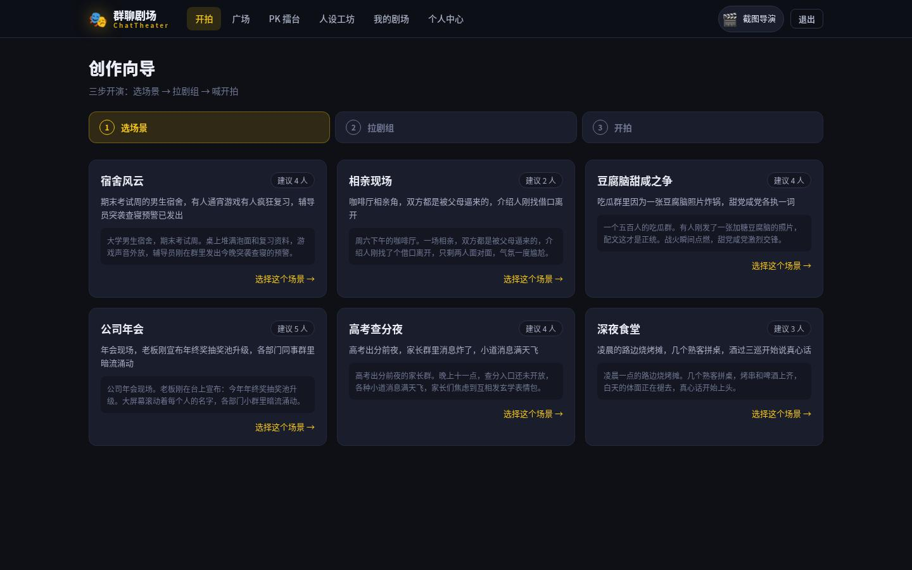
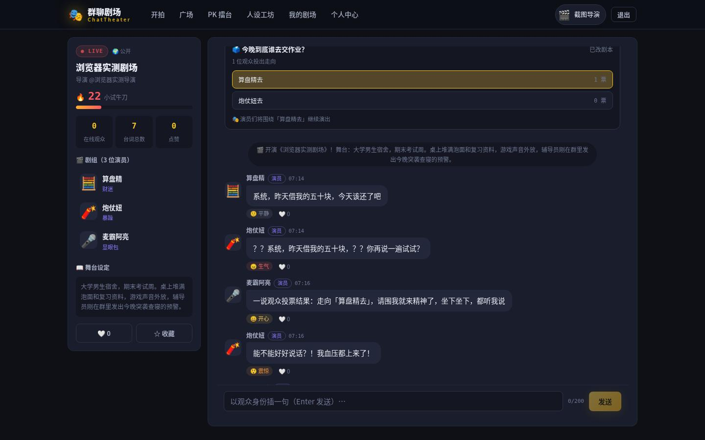
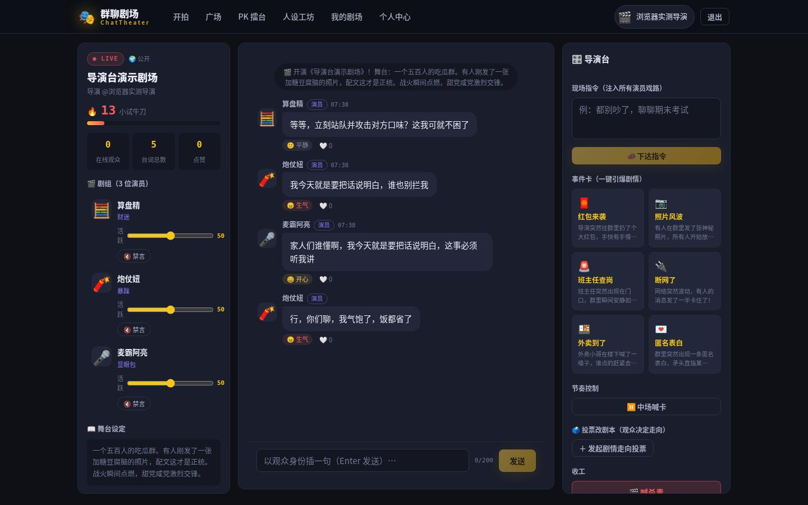
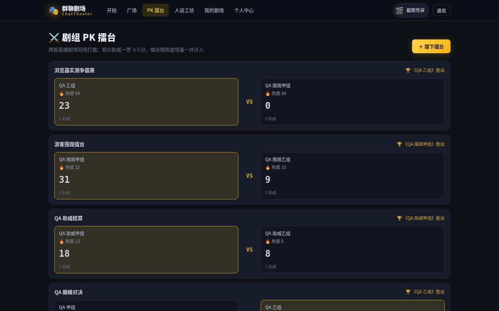
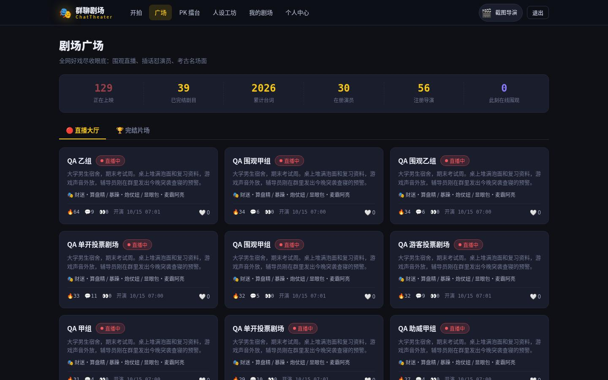
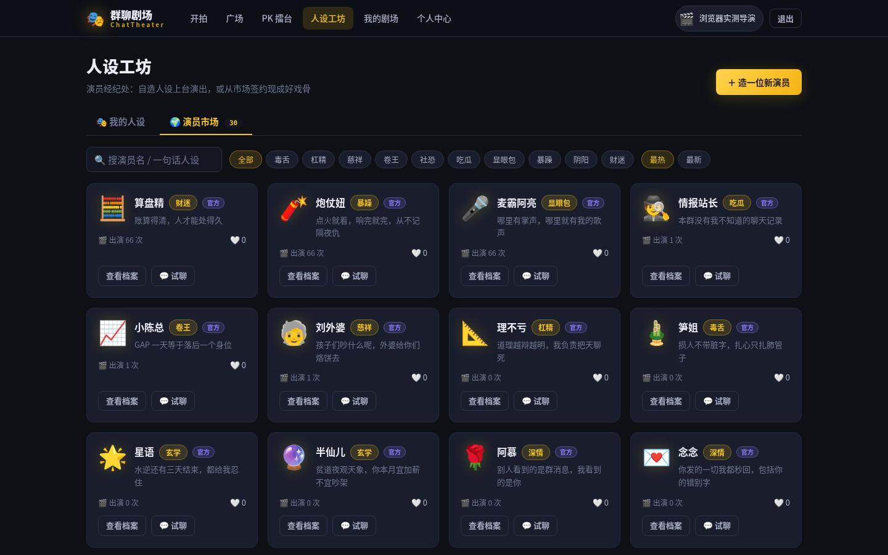
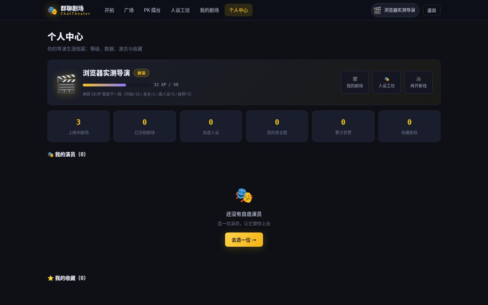
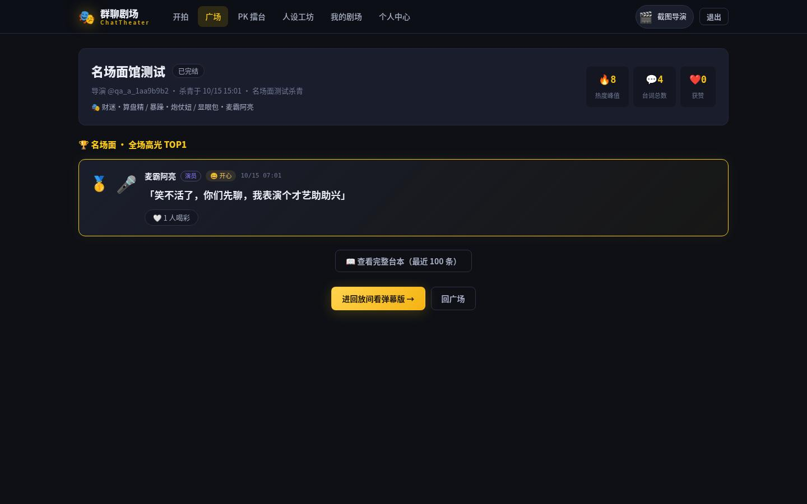

# ChatTheater 群聊剧场

> 把群聊变成舞台：选好剧本、签下演员、开拍一部由 AI 群演实时出演的互动剧，你就是导演。

ChatTheater 是一个 AI 群聊扮演 + 导演操控的娱乐平台。用户在「创作向导」里挑一个剧本场景、签下 2~6 位性格迥异的 AI 演员，开拍后演员们会在群里自动搭戏开吵；观众可以随时插话，AI 会即兴回怼；导演则在「导演台」里下指令、发事件卡、禁言捣乱的演员、拉抬活跃度，把剧情推向高潮。剧终杀青时，全场高赞台词自动沉淀进「名场面馆」。

**不配 LLM API Key 也能完整开演**——内置离线演员（Mock）模式，每位演员拥有按性格原型精心打磨的台词库与事件卡专属反应，零成本全功能可玩；填入 DeepSeek Key 则切换为真实大模型出演。

## 核心玩法

| 模块 | 内容 |
| --- | --- |
| 创作向导 | 6 部官方剧本（宿舍风云 / 相亲现场 / 豆腐脑甜咸之争…）+ 30 位官方演员，自建人设也能直接签约入组 |
| 实时剧场 | SSE 流式打字机气泡、AI 自动开吵、观众插话即兴回怼、消息点赞、实时热度、未读提示、历史分页回看 |
| 导演台 | 七种操控：台词指令、事件卡（红包 / 照片 / 班主任来了 / 断网 / 外卖 / 表白）、禁言 / 解禁、活跃度调节、暂停 / 续拍、**发起剧情走向投票** |
| 投票改剧本 | 导演发起 2~4 个剧情走向，观众一人一票实时改剧本；截止后胜出走向自动注入演员指令，AI 照观众选的演 |
| 剧组 PK 擂台 | 两部直播剧场同场打擂：观众助威一票计 3 分，叠加擂台期热度增量定胜负，胜者剧场热度大涨、导演加 XP |
| 人设工坊 | 六维人设卡（原型 / 性格 / 说话风格 / 背景故事 / 禁忌 / 宣传语）、试聊小黑屋、签约卡实时预览、市场双榜 |
| 剧情广场 | 全站数字带、直播中 / 已完结双榜、游客免登录围观公开剧场 |
| 名场面馆 | 杀青剧目的高光 TOP3 台词 + 完整台本回放 |
| 个人中心 | XP 成长体系（群演 → 场记 → 副导演 → 导演 → 金牌导演）、六维创作统计、我的演员、收藏夹 |
| 运营后台 | 数据看板、敏感词库 CRUD、审核日志、人设巡查上下架、近 7 日趋势 |

## 界面一览（运行效果截图）

以下截图来自真实运行的实例（离线演员模式，无需任何 API Key）：

| 首页 · 全站数字带与开拍入口 | 创作向导 · 挑剧本场景 |
| --- | --- |
|  |  |

| 实时剧场 · SSE 气泡与投票改剧本结算 | 导演台 · 指令 / 事件卡 / 节奏控制 / 喊杀青 |
| --- | --- |
|  |  |

| 剧组 PK 擂台 · 助威打榜定胜负 | 剧情广场 · 直播中 / 已完结双榜 |
| --- | --- |
|  |  |

| 人设工坊 · 演员市场（30 位官方演员） | 个人中心 · XP 成长档案 |
| --- | --- |
|  |  |

| 名场面馆 · 杀青高光 TOP3 + 台本回放 |
| --- |
|  |

## 技术架构

- **后端**：Spring Boot 3.3 + Java 17，MyBatis-Plus + MySQL 8，JWT 鉴权，SSE 实时推送，AI 网关（DeepSeek OpenAI 兼容协议，失败自动降级 Mock），敏感词审核覆盖注册昵称 / 人设 / 发言 / 试聊全入口
- **前端**：Vue 3.5 + Vite 5 + Pinia + Vue Router，16 个视图 / 7 大模块，全端响应式设计系统
- **质量**：pytest 接口自动化 114 用例全绿，含「人设守擂评测」——16 种性格原型各派一位演员连扛 6 轮挑衅，断言台词既像自己、又不串戏
- **部署**：Docker 多阶段构建 + docker compose 一键编排（MySQL + 后端 + nginx 前端），SSE 反代已调优

```
ChatTheater/
├── backend/            # Spring Boot 单体后端
│   └── src/main/java/com/chattheater/
│       ├── ai/         # LLM 网关、Mock 台词库、提示词构建
│       ├── theater/    # 剧场、消息、SSE 广播、调度器、导演台
│       ├── play/       # 新玩法：投票改剧本、多剧组 PK
│       ├── persona/    # 人设工坊与市场
│       ├── plaza/      # 广场与名场面馆
│       ├── me/         # 个人中心与 XP 成长
│       ├── admin/      # 运营后台
│       ├── moderation/ # 敏感词审核
│       └── security/   # JWT、登录拦截器、游客白名单
├── frontend/           # Vue 3 SPA（16 视图）
├── qa/                 # pytest 接口自动化（114 用例）
├── docker-compose.yml  # 一键编排
├── DESIGN.md           # 产品与技术设计文档
├── DEPLOY.md           # 部署指南
└── .env.example        # 环境变量样例
```

## 快速开始（从零跑起来）

### 第一步：安装必备软件

**方式一（推荐）Docker Compose：只需装 [Docker](https://www.docker.com/products/docker-desktop/)**

- Windows / macOS：下载 Docker Desktop 安装即可
- Ubuntu：`sudo apt install docker.io docker-compose-v2`，装完执行 `sudo usermod -aG docker $USER` 后重新登录（免 sudo 用 docker）

**方式二 本地开发：JDK 17 + Maven 3.9+ + Node.js 18+（MySQL 用下面命令顺手起）**

- JDK 17：[Eclipse Temurin 17](https://adoptium.net/temurin/releases/?version=17)
- Maven 3.9+：[官网下载](https://maven.apache.org/download.cgi)，解压后把 `bin` 目录加入 PATH
- Node.js 18+：[官网 LTS 版](https://nodejs.org/)

> Windows 用户：以下命令在 PowerShell 或 WSL 终端里执行均可。

### 第二步：把代码拉到本地

```bash
# 两种方式任选其一（SSH 更快，HTTPS 免配置）
git clone git@github.com:Wyy520-create/chattheater.git
# git clone https://github.com/Wyy520-create/chattheater.git
cd chattheater
```

### 第三步：启动服务（二选一）

**方式一：Docker Compose 一键启动（推荐）**

```bash
cp .env.example .env          # 按需修改配置（不改也能跑，默认离线演员模式）
docker compose up -d --build  # MySQL + 后端 + 前端 一起拉起
```

- 前端入口：http://localhost:8080
- 后端直连：http://localhost:8092（浏览器打开 `/api/plaza/stats` 能看到 JSON 即就绪）

> 首次启动 MySQL 初始化约 30~60 秒，后端会等数据库健康检查通过后再开始工作，属正常现象。建表与种子数据（30 官方演员 / 6 剧本 / 敏感词库）由后端启动时自动完成，**不需要手工导库**。

**方式二：本地开发（改代码调试用）**

```bash
# 1. MySQL（本机已有 8.0 实例可跳过，注意端口 3307）
docker run -d --name chattheater-mysql -p 3307:3306 \
  -e MYSQL_ROOT_PASSWORD=chattheater123 \
  -e MYSQL_DATABASE=chattheater \
  -e MYSQL_USER=chattheater \
  -e MYSQL_PASSWORD=chattheater123 \
  mysql:8.0 --character-set-server=utf8mb4 --collation-server=utf8mb4_unicode_ci

# 2. 后端（默认 8091，启动时自动建表灌种子）
cd backend && mvn spring-boot:run

# 3. 前端（新开一个终端；Vite dev 5173，已配置 /api 代理）
cd frontend && npm install && npm run dev
```

### 第四步：打开浏览器开玩

- 方式一打开 http://localhost:8080 ，方式二打开 http://localhost:5173
- 注册一个账号即可开拍；**不注册也能以游客身份逛广场、围观公开剧场、给剧组助威**

### 常见问题

| 问题 | 解决办法 |
| --- | --- |
| 启动报端口被占用 | 方式一：改 `.env` 里的 `FRONTEND_PORT` / `BACKEND_PORT` 后重新 `docker compose up -d --build`；方式二：把 `docker run` 的 `-p 3307:3306` 换成别的端口，并用 `SERVER_PORT=新端口 mvn spring-boot:run` 启动后端 |
| 页面能开但一直转圈 / 报网络错误 | 多半是后端还没就绪。浏览器访问 http://localhost:8092/api/plaza/stats （方式一）或 http://localhost:8091/api/plaza/stats （方式二），返回 `{"code":0,...}` 后再刷新页面 |
| 想让演员接真实大模型 | 按下面「AI 模式切换」里的「接入 DeepSeek 五步上手」走一遍；本地开发方式看同节末尾小节 |

## AI 模式切换

| 模式 | 配置 | 说明 |
| --- | --- | --- |
| 离线演员（默认） | `DEEPSEEK_API_KEY` 留空 | 按性格原型台词库出演，含事件卡专属反应，确定性可测 |
| 真实大模型 | 填入 DeepSeek API Key | OpenAI 兼容协议，换供应商只需改 `DEEPSEEK_BASE_URL` / `DEEPSEEK_MODEL` |

真实模式请求失败时自动降级 Mock 出演并记录上游错误，演出永不中断；所有调用（成功 / 降级）均落 `llm_usage` 表供运营看板统计。

### 接入 DeepSeek 五步上手（方式一）

1. **申请 Key**：打开 [DeepSeek 开放平台](https://platform.deepseek.com) 注册登录 → 先充值（按 token 用量计费，几块钱够玩很久）→ 左侧「API keys」→「创建 API key」→ 立即复制（只显示一次，格式形如 `sk-xxxxxxxx`）
2. **填入配置**：在项目根目录编辑 `.env`，把 `DEEPSEEK_API_KEY=` 等号后填上你的 key（注意等号两边不要加空格、key 不要带引号）：
   ```bash
   nano .env   # 找到 DEEPSEEK_API_KEY= 一行，粘贴 key；Ctrl+O 回车保存，Ctrl+X 退出
   ```
3. **重启生效**：
   ```bash
   docker compose up -d            # .env 有变化时会自动重建相关容器
   docker compose logs -f backend  # 可选：盯一眼后端日志确认启动成功
   ```
4. **验证**：新开一场戏，演员接话会明显更“活人”；想看调用统计，可用管理员账号进 `/admin` 数据看板（管理员开通见 [DEPLOY.md](DEPLOY.md) 第三节）
5. **失败也不慌**：Key 填错或欠费时后端会自动降级回离线演员模式，演出不中断，`docker compose logs backend` 里能看到降级原因

### 本地开发（方式二）怎么接 Key

`.env` 只有 docker compose 会读，**本地直接跑后端时它不读这个文件**，要用环境变量把 Key 传给后端：

```bash
cd backend
DEEPSEEK_API_KEY=sk-你的key mvn spring-boot:run     # 一次性写法：只对这个进程生效
# 或者先 export DEEPSEEK_API_KEY=sk-你的key，再 mvn spring-boot:run
```

换 Key 或换模型后：Ctrl+C 停掉，重新执行上面的命令即可；前端不用重启。

## 接口测试

```bash
cd qa
PYTEST_DISABLE_PLUGIN_AUTOLOAD=1 python3 -m pytest -v
```

- 114 个用例覆盖：注册登录鉴权、人设 CRUD 与越权矩阵、剧本、剧场全生命周期（建组约束 / 自动开吵 / 插话回怼 / 导演台七操作 / SSE 协议 / 杀青高光）、**观众投票改剧本全链路（发起校验 / 一人一票 / 截止结算注入剧情）**、**剧组 PK（摆擂校验 / 助威 / 结算胜负）**、敏感词四类入口拦截、游客边界、管理员守卫、广场与个人中心
- 人设守擂评测：每种原型 6 轮挑衅下，台词必须命中本原型锚词（像自己）且不命中其他原型锚词（不串戏）
- 测试目标地址可用 `CT_BASE` 环境变量切换，例如指向 compose 栈：`CT_BASE=http://localhost:8092 pytest -v`

## 环境变量

| 变量 | 默认值 | 说明 |
| --- | --- | --- |
| `SERVER_PORT` | `8080` | 后端端口（compose 内固定 8091，宿主映射默认 8092） |
| `MYSQL_HOST` / `MYSQL_PORT` | `localhost` / `3307` | 数据库地址（compose 内自动用服务名） |
| `MYSQL_DB` / `MYSQL_USER` / `MYSQL_PASSWORD` | `chattheater` / `chattheater` / `chattheater123` | 库与账号 |
| `JWT_SECRET` | 开发默认值 | 生产必须换成 32 位以上随机串 |
| `DEEPSEEK_API_KEY` | 空 | 留空即离线演员模式 |
| `DEEPSEEK_BASE_URL` / `DEEPSEEK_MODEL` | DeepSeek 官方 | OpenAI 兼容供应商可替换 |

完整部署细节、管理员开通与生产加固清单见 [DEPLOY.md](DEPLOY.md)，产品与模块设计见 [DESIGN.md](DESIGN.md)。

## 部署到公网

以下两种方式都假设你已经用「方式一：Docker Compose」把项目跑起来了。临时演示用 A，正式运营用 B。

### 方式 A：cpolar 内网穿透（几分钟上线，适合临时演示）

1. **注册拿 token**：[cpolar 官网](https://www.cpolar.com) 注册登录，在后台「验证」页复制你的 authtoken
2. **安装**（Linux 一行命令；Windows / macOS 去官网下载页装客户端）：
   ```bash
   curl -L https://www.cpolar.com/static/downloads/install-release-cpolar.sh | sudo bash
   ```
3. **绑定账号**：`cpolar authtoken 你的token`
4. **开隧道**：`cpolar http 8080`（穿透 compose 的前端；若用的是方式二本地开发，就 `cpolar http 5173`）
5. 终端会打印出一个公网地址（形如 `https://xxxx.cpolar.top`），发给任何人都能直接打开玩

注意事项：

- **公开前先把 `.env` 的 `JWT_SECRET` 换成随机串**（`openssl rand -hex 32` 生成），MySQL 默认密码也建议一并改掉
- 只穿透前端端口（8080 或 5173）就够，**不要**把 8092（后端直连口）、3306（数据库）暴露出去
- 免费版每次重启隧道域名都会变，固定域名需付费版；演示完 Ctrl+C 即关闭

### 方式 B：正式云服务器（长期上线）

1. **买服务器**：阿里云 / 腾讯云轻量应用服务器，2 核 2G 就够，系统选 Ubuntu 22.04
2. **放端口**：控制台「安全组」入方向放行 **80、22**（要上 HTTPS 再加 443）；**不要**放行 8092 / 3306
3. **装 Docker**（SSH 登录服务器后执行）：
   ```bash
   curl -fsSL https://get.docker.com | sudo bash
   sudo usermod -aG docker $USER && newgrp docker   # 重新加载权限，之后免 sudo 用 docker
   ```
4. **拉代码并配置**：
   ```bash
   git clone https://github.com/Wyy520-create/chattheater.git
   cd chattheater
   cp .env.example .env && nano .env
   ```
   生产必改三项：`JWT_SECRET` 填 `openssl rand -hex 32` 生成的随机串；`MYSQL_PASSWORD` 和 `MYSQL_ROOT_PASSWORD` 换成强密码（两处保持一致）；要真实演员出演再填 `DEEPSEEK_API_KEY`
5. **启动**：
   ```bash
   docker compose up -d --build
   ```
6. **验证**：浏览器访问 `http://服务器公网IP` 能看到首页即上线成功；`curl http://服务器公网IP/api/plaza/stats` 返回 `{"code":0,...}` 说明后端也就绪了
7. **（可选）绑域名 + HTTPS**：
   - 在域名控制台加一条 A 记录指向服务器公网 IP（国内服务器 + 国内域名需先完成备案）
   - 用 Caddy 自动申请并续期证书（Caddy 会占用 80/443，所以 `.env` 里 `FRONTEND_PORT` 保持 8080 不要动）：
     ```bash
     printf '你的域名.com\n\nreverse_proxy localhost:8080\n' > Caddyfile
     docker run -d --name caddy --network host \
       -v $PWD/Caddyfile:/etc/caddy/Caddyfile --restart unless-stopped caddy:2
     ```
     之后访问 `https://你的域名.com` 即可

日常运维（更多命令见 [DEPLOY.md](DEPLOY.md) 第六节）：看日志 `docker compose logs -f backend`；更新版本 `git pull && docker compose up -d --build`；数据库备份用 `mysqldump`（命令在 DEPLOY.md 第六节）。

## License

版权所有 (c) 2026 余阳辉（GitHub: [Wyy520-create](https://github.com/Wyy520-create)），保留所有权利。

未经许可，不得复制、修改、分发、再许可或用于商业用途。完整条款见 [LICENSE](LICENSE) 文件。
